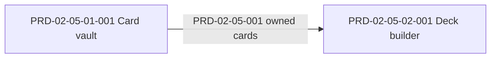

# Requirements diagrams

A diagram is a requirement. It defines which components exist and how they connect. The requirement behind each node defines what the component contains; the requirement behind each connection defines what the interface carries. Information is never duplicated: the diagram gives the structure, the requirements give the content.

## Where diagrams live

- **One layer:** a `## DIA-NNN title` section in the chapter file it shows, inside `docs/requirements/prd/` or `docs/requirements/tr/`: the `_index.md` of a folder for a diagram of its modules, or the module file for a diagram inside one module. Place it before the requirements. Keep these diagrams small.
- **Several layers:** one file per diagram in `docs/diagrams/`, named `DIA-NNN-short-name.md`, with one `## DIA-NNN title` section.
- IDs are DIA-001, DIA-002 and so on, unique across the repository, never renumbered or reused. Retire a diagram with Status: deprecated.

## Diagram section

~~~markdown
## DIA-001 Collection
- **Layer:** PRD
- **Type:** flowchart
- **Status:** draft


~~~

This diagram sits in `prd/02-game/05-collection/_index.md`. Each node is the main requirement of a module file (`01-vault.md`, `02-deck-builder.md`); the connection is an interface requirement of the `_index.md` with `Connects: 02-05-01, 02-05-02`.

Layer is BR, PRD, TR or a list for multi-layer diagrams. Status is draft, approved or deprecated.

## Element rules

1. Every node and every connection carries exactly one requirement ID (for example BR-02-01-001, PRD-02-05-001 or TR-02-01-003) at the start of its label, followed by a short name.
2. That requirement exists and lists the diagram in its `Diagram` field, for example `- **Diagram:** DIA-001`. A requirement in several diagrams lists all of them, comma-separated.
3. Every requirement whose `Diagram` field names a diagram appears in that diagram.
4. One element per line. Use only these forms:
   - flowchart (or graph): node `KEY["ID name"]` (any bracket shape); connection `A -->|ID name| B` (any arrow). Also allowed: `subgraph`, `end`, `direction`, `classDef`, `class`, `style`, `linkStyle`, comments `%%`.
   - stateDiagram-v2: state `state "ID name" as KEY`; transition `A --> B : ID name`. Transitions from or to `[*]` may have no label.
   - sequenceDiagram: `participant KEY as ID name` or `actor KEY as ID name`; message `A->>B: ID name` (any arrow). Also allowed: `autonumber`, `loop`, `alt`, `else`, `opt`, `par`, `and`, `critical`, `break`, `rect`, `end`, `Note`.
5. Other diagram types are not supported; describe them in requirements instead.

## Check

Run from the repository root:

```bash
python3 ~/.copilot/skills/requirements-diagrams/check_diagrams.py
```

It reads every file under `docs/requirements/` except `templates/` and `README.md` files, and `docs/diagrams/*.md`, prints every error, and exits with code 1 on any error. Diagram sections that still contain template placeholders in angle brackets are skipped and listed; the gate placeholder check reports them for the layer being gated. Fix every error before you finish a draft. The gate runs the same check; any error is a FAIL. Self-test of the checker: `python3 -I ~/.copilot/skills/requirements-diagrams/test_check_diagrams.py`.
