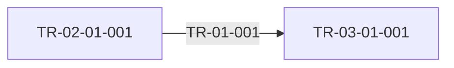

# <Component name>

Template for one TR chapter file in `docs/requirements/tr/`. Copy it to the component's place in the tree (see `tr/README.md`), as `NN-component-name.md` for a component or `_index.md` for a folder chapter, and delete these instructions.
Layer 3. Parent: product requirements. Describes how the solution must behave technically so that the product requirements are met.
One requirement per `##` section. IDs follow the file's location: `TR-<folder numbers>-<file number>-NNN` in a component file, `TR-<folder numbers>-NNN` in an `_index.md`. IDs are never reused or renumbered. Status is draft, approved or deprecated.
An interface between components goes into the lowest chapter that contains all of them (the folder's `_index.md`, or `01-general.md`) and names them in `Connects`. Delete the `Connects` line in other requirements.
Diagrams are requirements: see skill requirements-diagrams. Delete the example diagram if the chapter needs none.

## DIA-002 <diagram title>
- **Layer:** TR
- **Type:** <flowchart, stateDiagram-v2 or sequenceDiagram>
- **Status:** draft

## TR-02-01-001 <short title>
- **Statement:** The <component> shall ...
- **Parent:** PRD-02-05-01-001
- **Connects:** <component numbers, for example 02-01, 03-01, for an interface; otherwise delete this line>
- **Diagram:** <DIA-002 if this requirement is a node or connection in a diagram; otherwise delete this line>
- **Interfaces and constraints:** <inputs, outputs, limits, dependencies>
- **Acceptance criteria:**
  - AC1: <measurable condition with a threshold>
- **Verification level:** Integration test (tag tests with the TR ID); unit tests for module detail
- **Status:** draft
